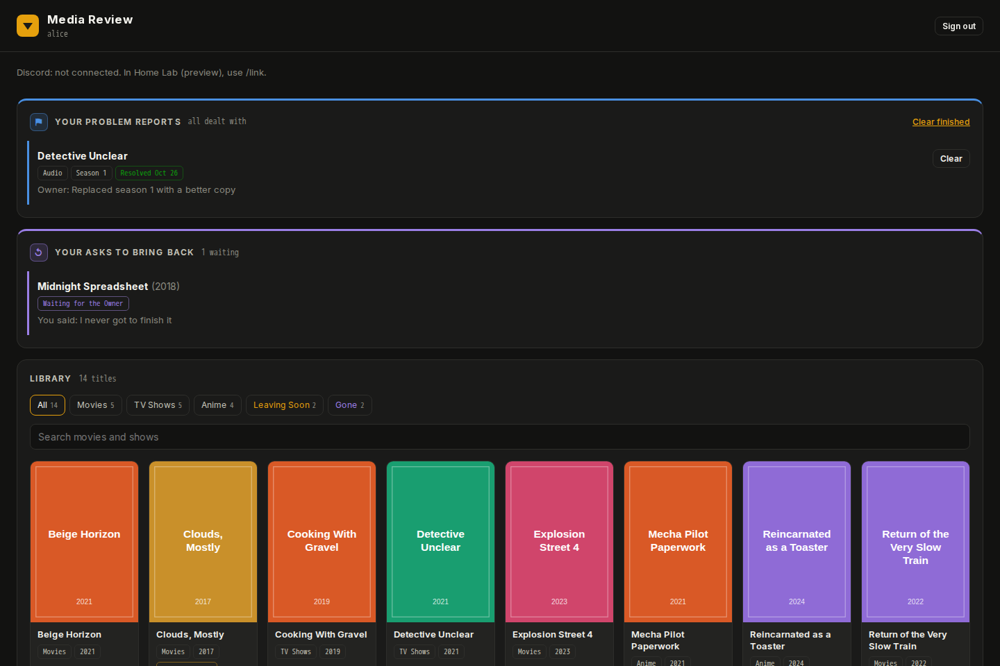
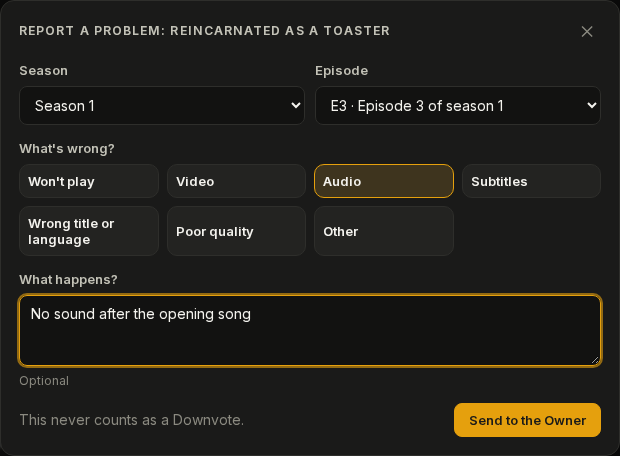
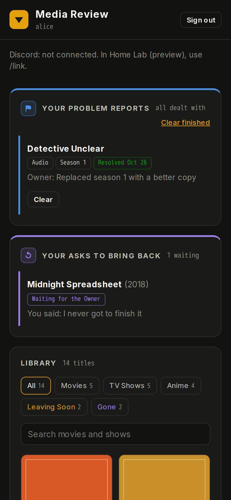
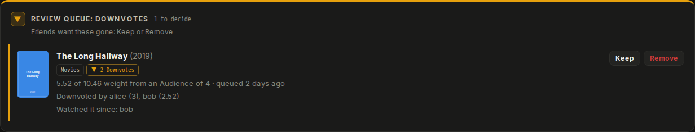
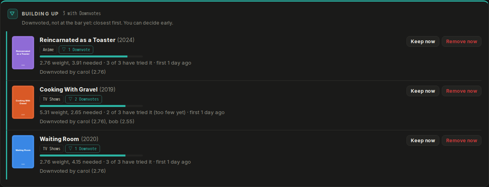
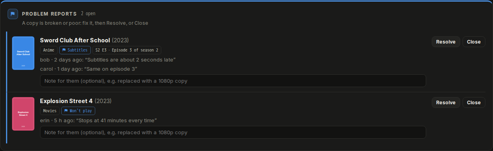
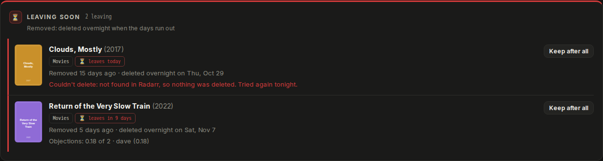
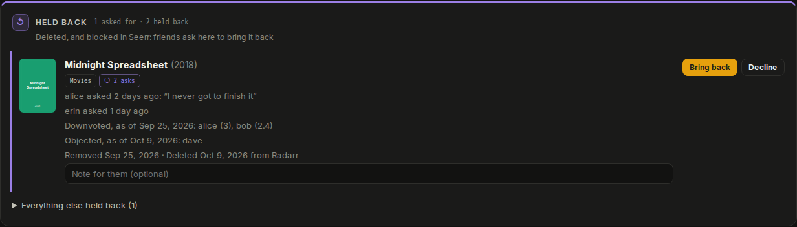
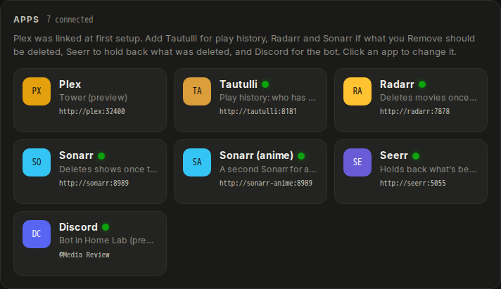

# Media Review

**Let the people you share Plex with tell you what's no longer worth keeping.**

Media Review is a companion app for a Plex server you share with friends and family. They Downvote
the movies and shows they think should go. When enough of the people who've actually tried a title
agree, it lands in your Review Queue, and you decide Keep or Remove. Nothing is ever removed
automatically. A title you Remove first spends two weeks in a pinned **Leaving Soon** collection in
Plex, so everyone gets a last chance to watch it, and only then is it deleted.

It runs as a single Docker container next to Plex. You set it up from a settings page in your
browser; there are no files to edit. It works on its own, and connects to
[Media Ops](https://github.com/KaiserHomeLab/media-ops) if you use that too.



<sub>Screenshots use made-up people and titles.</sub>

## How it decides

Not every Downvote is equal, and nobody can vote a title off the server without trying it first.

- **Only people who tried it count.** A Downvote counts once that friend has watched a real part of
  the title: 30 minutes of a movie, 10 minutes of a show. Until then they're told it doesn't count
  yet.
- **People who watch a lot weigh more.** Each friend's say grows with how much they've watched in
  the last 90 days, plus a bonus on titles they've tried.
- **A title goes to you** once at least 3 people have tried it and half of their combined weight
  has Downvoted it.
- **Watching it all takes the Downvote back.** If someone finishes a title they Downvoted, it no
  longer counts.

Every number is yours to change under **Settings → Rules**.

## What your friends can do

**Sign in with Plex** and browse your libraries (Movies, TV Shows, Anime, as you named them in
Plex). Downvote a title, or take a Downvote back. Friends only ever see their own Downvotes.

**Report a problem** with a copy: the whole movie, a show, one season or one episode, with what's
wrong and a note. If someone already reported the same thing, they add themselves to it ("me
too"). A Problem Report never counts as a Downvote.



**Object** when something they want is Leaving Soon. Enough Objections send it back to you to look
at again, once.

**Ask for it back** when a deleted title is missed. Deleted titles are blocked in Seerr, so they
can't simply be requested and downloaded again; friends ask you instead.

**Use Discord**, if you add the bot: `/downvote`, `/report`, `/object` and `/mine`, with title
autocomplete and replies only they can see.

**Hear about what they started.** A friend who connected Discord gets a DM when something they
started and haven't finished is Leaving Soon, and again on its last day. Not if they Downvoted it.
They can turn it off with `/reminders off` or on their page, and you can turn it off for everyone
under Settings → Discord.

Their own reports and asks keep themselves up to date, with a notice when you've answered one, and
a Discord DM too if they connected Discord.



## What you get

**A Review Queue** of titles that reached the bar: who Downvoted each one and how much each vote
weighed, who has watched it since, and whether you've Kept it before. **Keep** clears its
Downvotes. **Remove** sends it to Leaving Soon.



**Building up**: everything with Downvotes that hasn't reached the bar yet, closest first, so
nothing creeps up on you. You can Keep or Remove early.



**Problem Reports**, with everyone who has the problem and their notes. Fix the copy, then
**Resolve** it (or **Close** it if you won't), with a note they'll see.



**Leaving Soon**, with the date each title goes, any Objections so far, and **Keep after all**.
Deletion happens overnight through Radarr and Sonarr (a separate anime Sonarr too), with an
import-list exclusion so lists don't bring it straight back. If something can't be deleted, you're
told why, and it's tried again the next night.



**Held back**: deleted titles friends have asked for, with why each one went. **Bring back** takes
it off Seerr's blocklist and requests it. **Decline** keeps it held back.



**Discord, if you want it.** Announcements everyone sees (Leaving Soon with the poster, a last-day
reminder, fixed problems), which never name who Downvoted. Plus a private channel for you: new
Review Queue entries, Problem Reports, asks, failed deletions, and any app that's been unreachable
for an hour.

## Make it yours

**Settings → Appearance** sets light or dark (or follows each device), the accent color (Plex
amber, Jellyfin purple, Emby green, blue, teal or red), your own title and your own logo, for every
page, your friends' included. They're the same options as Media Ops', so the two can match. The
section colors (Downvotes amber, Problem Reports blue, Leaving Soon red, Held back purple, Building
up teal) never change, so a section always looks like itself.

## Install

**Unraid.** Save [`unraid-template.xml`](unraid-template.xml) to your flash drive as
`/boot/config/plugins/dockerMan/templates-user/my-media-review.xml`, then go to **Docker → Add
Container** and pick **media-review**. Before you click **Apply**:

- Set **Network Type** to the custom network Plex, Tautulli, Radarr and Sonarr are on, so Media
  Review can reach them by container name (`http://plex:32400`, `http://tautulli:8181`…).
- Keep **Appdata** on the cache pool. SQLite is unreliable through `/mnt/user`'s FUSE layer unless
  appdata is an exclusive share, so use `/mnt/cache/appdata/media-review` if it isn't.

**Anywhere else with Docker**, on the same network as Plex:

```bash
docker run -d --name media-review --restart unless-stopped -p 8485:8485 \
  --network YOUR-NETWORK \
  -e PUID=$(id -u) -e PGID=$(id -g) -e TZ=America/Chicago \
  -v ~/media-review:/config \
  --log-opt max-size=10m --log-opt max-file=3 \
  ghcr.io/kaiserhomelab/media-review:latest
```

**Want to control when it updates?** `latest` always has the newest version. Use `:0.9` instead
to get fixes but not new features, or `:0.9.0` to stay on exactly that version. What changed in
each version is in the [changelog](CHANGELOG.md) and on the
[releases page](https://github.com/KaiserHomeLab/media-review/releases). Settings → Status says
when a newer version is out.

## First steps

1. **Claim it.** Open the container's log (Unraid: **Docker → media-review → Logs**). It shows a
   one-time **setup code**. Open the web UI (`http://<your-server>:8485`), enter the code, and sign
   in with the Plex account that owns your server. You become its Owner. Do this before you make it
   reachable from outside: the code is what stops anyone else from claiming it.
2. **Pick your server** and the address Media Review uses to reach it, for example
   `http://plex:32400`.
3. **Add your apps** under **⚙ Settings → + Add app**, each with **Test** and **Save**. Tautulli is
   needed, because it's where play history comes from. Add Radarr, Sonarr and Sonarr (anime) if
   what you Remove should be deleted, and Seerr to hold deleted titles back. Saved API keys are
   never shown again, and leaving the key blank keeps the saved one.
4. **Mark your anime library** under **Settings → Rules**, if you have one.



### Letting friends in, with a Cloudflare Tunnel

Add a public hostname, for example `review.example.com`, with the service
`http://media-review:8485`. The cloudflared container must be on the same network. Then put
`https://review.example.com` in **Settings → Public address**, so Plex sign-in comes back there
and stays on https. Friends sign in with their own Plex accounts; anyone your server isn't shared
with is turned away.

### Discord

1. Go to <https://discord.com/developers/applications>, press **New Application** and name it.
2. Under **Bot**, press **Reset Token** and copy the token. No privileged intents are needed.
3. Under **OAuth2 → URL Generator**, tick `bot` and `applications.commands`, and under Bot
   Permissions tick **Send Messages** and **Embed Links**. Open the link it makes and add the bot
   to your server.
4. In Media Review, go to **Settings → + Add app → Discord**. Paste the token, press **Test**, pick
   your server, the **announcements** channel and **your channel** (one only you can see), and
   **Save**.

The bot connects out to Discord, so commands work without opening anything up. A friend's first
command gets them a one-time link to connect their Discord to their Plex account.

### Media Ops

On **Settings**, generate a key under **Media Ops**. In Media Ops, go to **Settings → Add app →
Media Review** with `http://media-review:8485` and that key. Its Review Queue card then shows the
queue, Building up, Problem Reports, asks and Leaving Soon, and you can decide from either app.

## If something isn't working

**Settings → Status** shows what Media Review last did on its own: the sync with Plex and Tautulli,
who has access, overnight deletion, holding back in Seerr, the Plex collection and Discord. Each one
has a green or red dot, and says what went wrong in words. **Sync now** runs it all straight away.
**Run diagnostics** checks every app live, and **Copy short report** gives you something to paste
into a GitHub issue, with no keys, tokens, IP addresses or names.

- **A red dot on an app in Settings** comes with what's wrong underneath, in words. It's usually
  the wrong address, a container on another network, or a wrong key. Fix it and press **Test**.
- **The log** says what each sync and each overnight deletion did:
  `docker logs --tail 100 media-review`. It never contains API keys or tokens, so it's safe to
  paste into a GitHub issue.
- **Lost the setup code?** Restart the container. A new one is printed at each start until setup
  is done.

## Good to know

- **Your data** is one file, `media-review.db`, in the folder you mapped to `/config`: every
  Downvote, decision, report and setting. Back up that folder and you've backed up everything.
- **Backups are made for you.** Each night, before anything is deleted, a copy goes to
  `/config/backups` (the newest 7 are kept), and Settings → Status has a **Download backup**
  button. A backup holds your app keys and tokens too, so keep it private. To restore one, stop the
  container, put the copy in `/config` as `media-review.db`, and start it again.
- **Your API keys stay on the server.** They're never sent to a browser.
- **Nothing is deleted without you.** A title is only deleted after you Removed it and its Leaving
  Soon ran out. Deletion runs overnight, between 04:00 and 07:00 in the container's time zone.
- **Friends never see who Downvoted or objected.** Only you do, and Discord announcements never
  name anyone.

More detail is in [SECURITY.md](.github/SECURITY.md).

### Container options

Media Review is built like a [linuxserver.io](https://www.linuxserver.io/) image, so the usual
options work:

| Variable | Default | What it does |
|---|---|---|
| `PUID` / `PGID` | `911` | The user the app runs as. Unraid: `99` / `100`. Linux: run `id`. |
| `TZ` | `Etc/UTC` | Your time zone, like `America/Chicago`. Decides when "overnight" is, for deletions. |
| `UMASK` | `022` | File permissions for new files. |
| `SYNC_MINUTES` | `15` | How often to read Plex and Tautulli. |
| `PORT` | `8485` | The port inside the container. |

## API for Media Ops

Every request sends the key as `X-Api-Key`. The Owner's own pages use the same routes under
`/api/owner/`, with their session instead of the key.

- `GET /api/v1/status`: `{ app: "media-review", version }`
- `GET /api/v1/health`: what's wrong right now, as `[{ type: "error" | "warning", source, message }]` (the shape Sonarr and Radarr use): a background job that failed its last run, a Title that couldn't be deleted overnight, no sync for over an hour, or the Discord bot not connected. Media Ops shows these under Errors & warnings.
- `GET /api/v1/review-queue`: `{ reviewQueue: [...] }`, one entry per Title waiting for the Owner, with each Downvote's Voter and Vote Weight
- `POST /api/v1/review-queue/:ratingKey/keep` and `…/remove`: the Owner's decision. Remove answers `{ removed: true, endsAt }`
- `GET /api/v1/building-up`: `{ buildingUp: [...] }`, the Titles with Downvotes that haven't reached the bar yet, closest first. Each has its weight so far, the weight needed, the Audience against the Minimum Audience, `progress` (0–1), and each Downvote with its Voter, the weight it adds now, and whether it counts yet
- `POST /api/v1/building-up/:ratingKey/keep` and `…/remove`: the Owner deciding before the bar
- `GET /api/v1/leaving-soon`: `{ leavingSoon: [...] }`, each with `endsAt` and `daysLeft`
- `POST /api/v1/leaving-soon/:ratingKey/keep`: Keep after all
- `GET /api/v1/problem-reports`: `{ problemReports: [...] }`, the open Problem Reports, oldest first, each with its Title, the part (`"S2 E3 · Title"`, `"Season 2"`, or `null` for the whole Title), the reason, and every reporter with their note
- `POST /api/v1/problem-reports/:id/resolve` and `…/close`: the Owner's decision, with an optional `{ "note": "…" }` the reporters see
- `GET /api/v1/held-back`: `{ heldBack: [...] }`, deleted Titles blocklisted in Seerr, the ones friends asked for first, each with who asked and the Title's history
- `POST /api/v1/held-back/:ratingKey/bring-back` and `…/decline`: the Owner's decision, with an optional `{ "note": "…" }` for the friends who asked
- `GET /api/v1/poster/:ratingKey`: the Title's poster

## What's in this repo

| | |
|---|---|
| [`unraid-template.xml`](unraid-template.xml) | Unraid template |
| [`CHANGELOG.md`](CHANGELOG.md) | What changed in each version |
| [`CONTEXT.md`](CONTEXT.md) | What the words mean: Downvote, Audience, Sample, Leaving Soon… |
| [`docs/spec.md`](docs/spec.md) | Exactly what it does, and why |
| [`src/`](src/) | The source code and the Dockerfile (see [CONTRIBUTING](.github/CONTRIBUTING.md) to work on it) |

## License and thanks

Media Review is free and open source under the [MIT License](LICENSE).

It's only possible because of the apps it talks to: Plex, Tautulli, Radarr, Sonarr, Seerr and
Discord. Thanks also to linuxserver.io for the base image. Media Review only uses their public
APIs and doesn't include any of their code. Licenses and links are in
[THIRD-PARTY-NOTICES.md](src/THIRD-PARTY-NOTICES.md).

Plex and the other app names are trademarks of their owners. Media Review is an independent
project and isn't affiliated with or endorsed by any of them.
